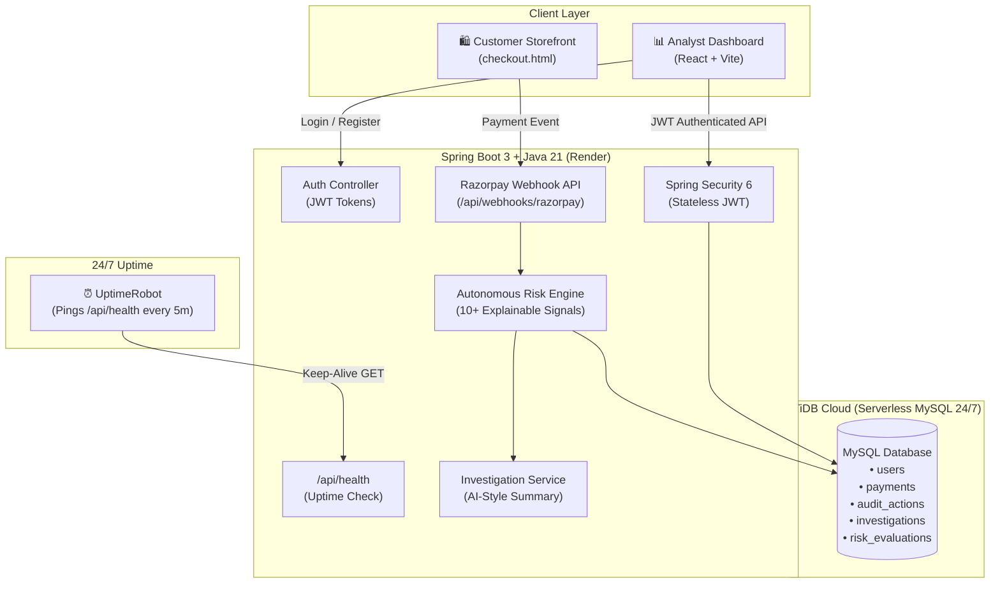

# 🛡️ Sentinel RiskOps

**Sentinel RiskOps** is a full-stack, autonomous, and explainable payment fraud detection & risk management platform. It analyzes real-time Razorpay payment streams, scores risk based on velocity, amount anomalies, card metadata, and IP patterns, and provides an interactive analyst dashboard with one-click decision-making (Allow / Review / Block).

---

## 🌐 Live Cloud Deployment (24/7 Free)

| Layer | Platform | Live URL / Status |
|---|---|---|
| **Frontend Dashboard** | **Vercel** | `https://<your-project>.vercel.app` |
| **Customer Storefront** | **Vercel** | `https://<your-project>.vercel.app/checkout.html` |
| **Backend API** | **Render (Docker)** | `https://sentinel-riskops.onrender.com` |
| **Database** | **TiDB Cloud (Serverless)** | AWS Tokyo MySQL Cluster (`sentinel_riskops`) |
| **Health Monitor** | **UptimeRobot** | `https://sentinel-riskops.onrender.com/api/health` (Status: **UP 🟢**) |

---

## 🏗️ System Architecture



---

## 🛍️ How `checkout.html` Works

The **Customer Storefront Simulator** (`sentinel-ui/public/checkout.html`) simulates real customer purchases, card attempts, and card-testing attack scenarios without needing real money.

### 1. Razorpay Integration
- Loads official `https://checkout.razorpay.com/v1/checkout.js`.
- Configured with test key (`rzp_test_...`) and customizable inputs (Customer Email, Phone, Amount in INR).

### 2. Attack & Customer Simulation
- **Legitimate transaction**: Regular email (`customer@gmail.com`), typical amount (`₹500 - ₹5,000`), Visa/Mastercard.
- **Card testing attack**: Repeated high-frequency requests, prepaid cards, or rapid failures (`attacker@example.com`).
- **High-risk velocity**: Triggering multiple transactions in a short window from the same IP/email.

### 3. Smart Webhook Dispatch
When a payment succeeds or fails in the Razorpay popup:
- The script constructs a standard Razorpay webhook payload (`payment.captured` or `payment.failed`).
- **Environment Auto-Detection**:
  ```javascript
  var backendBase = (window.location.hostname === 'localhost' || window.location.hostname === '127.0.0.1')
      ? 'http://localhost:8080'
      : 'https://sentinel-riskops.onrender.com';
  ```
- Posts the webhook payload directly to `/api/webhooks/razorpay`.

### 4. Instant Dashboard Telemetry
Within milliseconds of clicking *"Pay"*:
1. The backend ingests the payload.
2. The Risk Engine calculates a **Risk Score (0–100)** and risk level (**LOW / MEDIUM / HIGH / CRITICAL**).
3. The transaction instantly reflects in the **Analyst Dashboard** with automated explanations (e.g., *"Velocity anomaly: 3 payments in last 10 minutes"*).

---

## 🚀 How We Deployed 24/7 for Free

### Step 1: TiDB Cloud Serverless (MySQL Database)
1. Created a free **TiDB Serverless** cluster on AWS (5GB storage, 50M request units/month free forever).
2. Generated SSL connection credentials and created the database `sentinel_riskops`.
3. Hibernate automatically manages schema creation on startup (`spring.jpa.hibernate.ddl-auto=update`).

### Step 2: Render (Spring Boot Docker Backend)
1. Created a multi-stage [`Dockerfile`](Dockerfile) with Eclipse Temurin Java 21 to ensure reproducible, zero-configuration cloud builds:
   ```dockerfile
   FROM eclipse-temurin:21-jdk-alpine AS builder
   WORKDIR /app
   COPY .mvn/ .mvn/
   COPY mvnw pom.xml ./
   RUN chmod +x mvnw && ./mvnw dependency:go-offline -B || true
   COPY src ./src
   RUN ./mvnw clean package -Dmaven.test.skip=true

   FROM eclipse-temurin:21-jre-alpine
   WORKDIR /app
   COPY --from=builder /app/target/*.jar app.jar
   EXPOSE 8080
   ENV PORT=8080
   ENTRYPOINT ["java", "-jar", "app.jar"]
   ```
2. Connected GitHub repo `Sentinel_RiskOps` to Render as a **Free Web Service**.
3. Configured environment variables on Render:
   - `SPRING_DATASOURCE_URL`: `jdbc:mysql://<tidb-host>:4000/sentinel_riskops?sslMode=VERIFY_IDENTITY&enabledTLSProtocols=TLSv1.2,TLSv1.3`
   - `SPRING_DATASOURCE_USERNAME`: `<tidb-user>`
   - `SPRING_DATASOURCE_PASSWORD`: `<tidb-password>`
   - `JWT_SECRET`: 256-bit secure secret key
   - `PORT`: `8080`

### Step 3: UptimeRobot (24/7 Keep-Alive Monitor)
- Render free instances spin down after 15 minutes of inactivity.
- We added a dedicated public health check endpoint: **`/api/health`** (returns HTTP 200 `{"status":"UP"}`).
- Configured a free HTTP(s) monitor on **UptimeRobot** that pings `https://sentinel-riskops.onrender.com/api/health` every **5 minutes**.
- **Result:** Render never detects inactivity and runs **24/7 continuously at zero cost**.

### Step 4: Vercel (Frontend Dashboard & Storefront)
1. Connected `Sentinel_RiskOps` to Vercel.
2. Set **Root Directory** to `sentinel-ui`.
3. Set Environment Variable: `VITE_API_BASE_URL=https://sentinel-riskops.onrender.com`.
4. Configured [`vercel.json`](sentinel-ui/vercel.json) rewrite rules so that:
   - `checkout.html` is served directly without SPA router interference.
   - All other routes resolve to `index.html` for client-side routing.

---

## 🔒 Security Architecture

- **Stateless JWT Authentication**: Passwords hashed with **BCrypt (cost factor 12)**. Auth tokens expire in 24 hours.
- **Role-Based Access Control**:
  - `ROLE_ANALYST`: View transactions, inspect risk telemetry, submit approve/block decisions.
  - `ROLE_ADMIN`: All analyst permissions plus dashboard reset and administrative actions.
- **Webhook Exemption**: `/api/webhooks/razorpay` is exempted from JWT auth to receive external payment gateways.
- **Public Health Check**: `/` and `/api/health` are publicly reachable for load balancers and uptime monitors.

---

## 💻 Local Development Setup

### Prerequisites
- Java 21 JDK
- Node.js 18+ & npm
- MySQL Server (or local Workbench)

### 1. Database Setup
Ensure MySQL is running locally and create the database:
```sql
CREATE DATABASE IF NOT EXISTS sentinel_riskops;
```

### 2. Start Backend (Spring Boot)
```powershell
cd D:\Sentianal\demo
.\mvnw.cmd spring-boot:run
```
The backend starts on `http://localhost:8080`.

### 3. Start Frontend (React + Vite)
```powershell
cd D:\Sentianal\demo\sentinel-ui
npm install
npm run dev
```
The dashboard starts on `http://localhost:5173`.

### 4. Open Checkout Store
Open `http://localhost:5173/checkout.html` in your browser (or click the **"Checkout Store"** button directly on the top header of the dashboard) to simulate live payments.

---

## 📡 API Reference

| Method | Endpoint | Access | Description |
|---|---|---|---|
| `GET` | `/api/health` | Public | Service health status (`{"status":"UP"}`) |
| `POST` | `/api/auth/register` | Public | Register new analyst/admin account |
| `POST` | `/api/auth/login` | Public | Authenticate user & receive JWT token |
| `GET` | `/api/auth/me` | Authenticated | Retrieve current user profile |
| `POST` | `/api/webhooks/razorpay` | Public | Ingest single or batch Razorpay payment events |
| `GET` | `/api/dashboard/payments` | Analyst / Admin | Fetch all payments with risk telemetry |
| `PATCH` | `/api/dashboard/payments/{id}/decision` | Analyst / Admin | Approve or block a flagged payment |
| `GET` | `/api/dashboard/payments/{id}/audit` | Analyst / Admin | View decision audit trail history |
| `DELETE` | `/api/dashboard/payments` | Admin | Reset payment database |
| `GET` | `/api/evaluation/benchmark` | Authenticated | Model evaluation metrics (Precision, Recall, F1) |

---

## ⚖️ License & Credits

Developed as part of the **Sentinel AI Risk Operations** initiative. Powered by Spring Boot, React, TiDB Cloud, Render, and Vercel.
