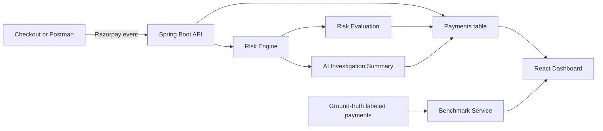

# Sentinel

Sentinel is an explainable payment-risk operations MVP for detecting suspicious Razorpay transactions, storing risk telemetry, and helping a merchant decide whether to allow, review, or block a payment.

Detailed architecture: [docs/ARCHITECTURE.md](docs/ARCHITECTURE.md)

## Product Flow



1. A payment event arrives from `checkout.html`, Razorpay, or Postman.
2. The Backend validates and stores it in the MySQL `payments` table.
3. The Risk Engine calculates a score from observable payment signals.
4. The Investigation Service turns those signals into a readable recommendation.
5. The React Frontend displays transactions, review cases, explanations, and decisions.
6. Labeled payments with `is_fraud` are evaluated by the Benchmark Service.

## Architecture

### Frontend

Location: `sentinel-ui/`

- React 19 with Vite
- Dashboard views: Overview, Transactions, Review Queue, Analytics, Settings
- Polls the Backend every three seconds for live payment data
- Displays risk explanations and benchmark metrics

Run it:

```powershell
cd sentinel-ui
npm install
npm run dev
```

Open `http://localhost:5173`.

### Backend

Location: `src/main/java/Sentina/demo/`

- Spring Boot REST API
- Razorpay webhook ingestion
- Batch webhook ingestion for arrays of events
- Explainable rule-based risk scoring
- Investigation summaries and analyst decisions
- Live model evaluation endpoint

Run it:

```powershell
.\mvnw.cmd spring-boot:run
```

The API runs on `http://localhost:8080`.

### Database

Configured in `src/main/resources/application.properties`.

The application uses MySQL database `sentinel_riskops` and stores payments in the existing `payments` table. Hibernate adds Sentinel risk columns to that table when `spring.jpa.hibernate.ddl-auto=update` is enabled.

Important payment fields:

- Core payment data: `payment_id`, `amount`, `status`, `payment_method`, `customer_id`
- Risk telemetry: `risk_score`, `risk_level`, `risk_confidence`, `triggered_signals`
- Investigation data: `evidence_summary`, `suggested_action`
- Evaluation label: `is_fraud`

Related tables are `risk_evaluations`, `investigations`, and `audit_actions`.

## Risk Engine

The Risk Engine is intentionally explainable for the MVP. It evaluates:

- Customer transaction velocity in the last 10 minutes
- Recent failed attempts in the last 30 minutes
- High transaction value
- Shared or repeated IP activity in the last 24 hours
- International payment activity
- Prepaid card usage
- Unknown card network
- Missing customer profile
- Failed payment status

The score maps to a risk level:

- `LOW`: below 20
- `MEDIUM`: 20 to 39
- `HIGH`: 40 to 69
- `CRITICAL`: 70 and above

The model recommendation is `ALLOW`, `REVIEW`, or `BLOCK`. The analyst can approve or block a flagged transaction from the dashboard, and the action is written to `audit_actions`.

## Webhook API

Endpoint:

```http
POST http://localhost:8080/api/webhooks/razorpay
Content-Type: application/json
```

The endpoint accepts either one event object or an array of event objects. Each payment must have a unique `id`.

For benchmark evaluation, include the label:

```json
"is_fraud": true
```

or:

```json
"is_fraud": false
```

`is_fraud` is ground truth for evaluation only. It does not influence the risk score.

## Benchmark API

```http
GET http://localhost:8080/api/evaluation/benchmark
```

The Benchmark Service evaluates only database payments where `is_fraud` is present. It reports:

- True Positives, False Positives
- True Negatives, False Negatives
- Precision, Recall, F1 Score
- Configured false-positive cost
- Estimated total false-positive cost

If no labeled payments exist, the endpoint returns `status: NO_LABELED_PAYMENTS` instead of presenting fabricated metrics.

## Demo Script

1. Start MySQL, Backend, and Frontend.
2. Open the dashboard and show the live transaction count.
3. Send a legitimate labeled event from Postman.
4. Send a suspicious labeled event from Postman.
5. Refresh Transactions and open the suspicious payment.
6. Explain the score, signals, recommendation, and audit decision.
7. Open Analytics and show live Precision, Recall, F1, and confusion-matrix counts.
8. Open Settings and show that the Analytics engine is active.

## Tests

Backend:

```powershell
.\mvnw.cmd test
```

Frontend:

```powershell
cd sentinel-ui
npm run build
npm run lint
```

## Honest MVP Positioning

Sentinel currently uses explainable rule-based scoring rather than a trained machine-learning model. The labeled data path and benchmark metrics are ready for future model training and threshold tuning. This makes the MVP easy to demonstrate, inspect, and defend technically.
