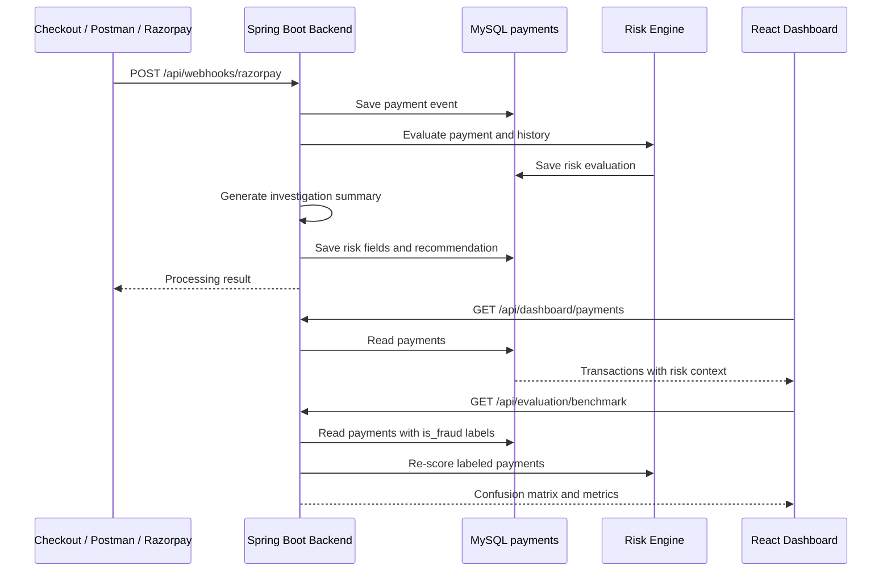

# Sentinel Architecture

## System Boundary

Sentinel has four clear responsibilities:

| Layer | Responsibility | Location |
| --- | --- | --- |
| Frontend | Live operations dashboard and analyst actions | `sentinel-ui/` |
| Backend | Ingestion, scoring, investigations, decisions, evaluation | `src/main/java/Sentina/demo/` |
| Database | Payments, risk evaluations, investigations, audit history | MySQL `sentinel_riskops` |
| Benchmarking | Metrics against labeled payment outcomes | `ModelEvaluationService` |

## Runtime Flow

## Payment Lifecycle

1. **Ingest**: The webhook controller accepts one event or a batch array.
2. **Validate**: Payment ID, amount, duplicate status, and optional signature are checked.
3. **Persist**: The event is stored in the canonical `payments` table.
4. **Score**: The Risk Engine combines payment attributes with recent database history.
5. **Explain**: The Investigation Service converts raw signals into a structured analyst report.
6. **Decide**: An analyst can approve or block the payment; the action is audited.
7. **Evaluate**: Labeled rows are rescored and compared with `is_fraud` ground truth.

## Ground Truth and Prediction

`is_fraud` answers: “Was this payment actually fraudulent?” It is supplied by a test dataset, later investigation, or confirmed business outcome.

The Risk Engine prediction is derived from the score:

- Score `>= 20`: predicted fraud / flagged
- Score `< 20`: predicted legitimate / allowed

The label is never used to calculate the score. This prevents data leakage and keeps Precision and Recall meaningful.

## Metric Definitions

- **TP**: Fraudulent payment correctly flagged
- **FP**: Legitimate payment incorrectly flagged
- **TN**: Legitimate payment correctly allowed
- **FN**: Fraudulent payment missed
- **Precision**: `TP / (TP + FP)`
- **Recall**: `TP / (TP + FN)`
- **F1 Score**: harmonic mean of Precision and Recall
- **False-positive cost**: `FP × configured cost per legitimate payment flagged`

## Key Endpoints

| Method | Endpoint | Purpose |
| --- | --- | --- |
| `POST` | `/api/webhooks/razorpay` | Ingest one or many payment events |
| `GET` | `/api/dashboard/payments` | Read live transactions |
| `PATCH` | `/api/dashboard/payments/{paymentId}/decision` | Approve or block a payment |
| `GET` | `/api/dashboard/payments/{paymentId}/audit` | Read analyst decisions |
| `GET` | `/api/evaluation/benchmark` | Evaluate labeled database payments |
| `DELETE` | `/api/dashboard/payments` | Reset local demo data |

## Design Decisions

- `payments` is the single canonical payment table for both external ingestion and dashboard reads.
- Risk data is denormalized onto `payments` for fast dashboard reads, while detailed evaluations remain in `risk_evaluations`.
- The current scoring implementation is explainable rules, not a trained ML model.
- Benchmark results are empty until real labels are present; the system does not invent metrics.
- Startup backfill evaluates older unscored payments so historical rows become visible to the same dashboard workflow.
